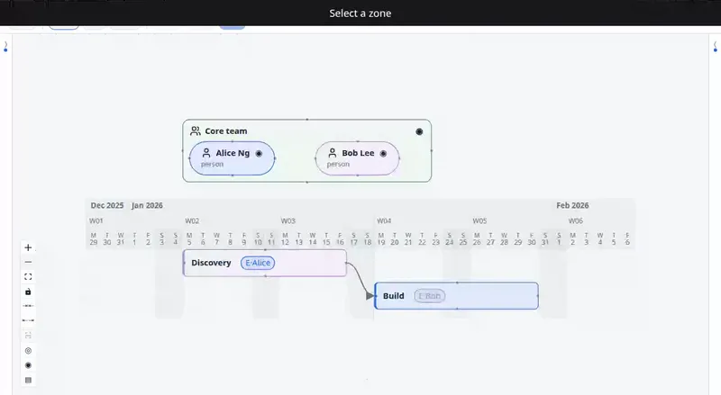
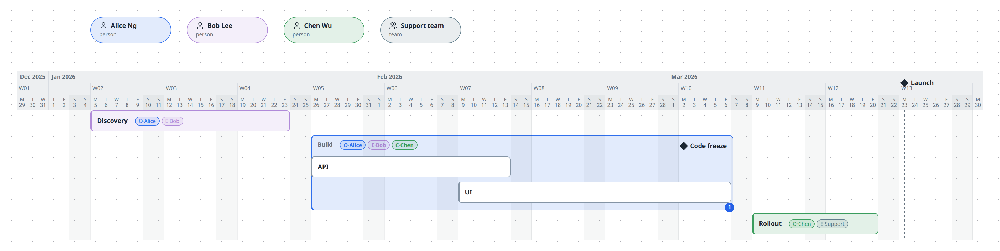
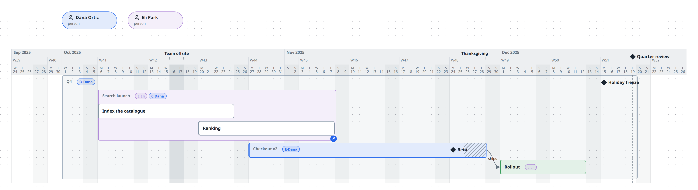
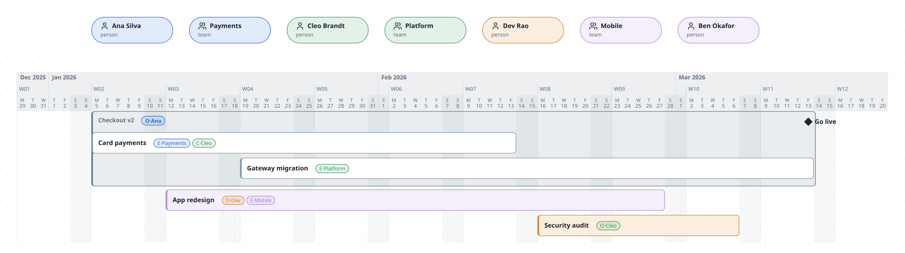

# Draw a plan

A schedule: zones as date bars that nest, events as milestones, people or teams attached to a zone as owner, executor or checker. A calendar runs left to right — the layout, not you, places every box on that axis — and containment is what is scheduled inside what, so a phase with two work streams is a zone with two nested zones.

## In the studio

1. Create a new diagram (or add a plane to an existing one) and, in **Layers & planes**, set its **Notation** to _Plan (schedule)_.
2. Press **Edit**. The **Plan** panel appears on the right.
3. Drop a **Zone** from the Library's *Plan* category — it lands two weeks wide at the date under the pointer (a zone dropped inside another starts where its parent does) — and name it; drop a second zone **onto** the first to nest it. A node turned into a Zone or Event afterwards (Properties → Type, or a Plan card applied to the selection) is dated the same way: today, or its parent's start when it is already nested. Select a zone or event and press **+** to add its successor instead of dropping a new one — the next zone starts the day after this one ends and runs the same length, the next event lands a week later — both clamped inside the parent and linked back with a dependency arrow.
4. Drag a bar sideways to move its dates by whole days (a nested bar stays inside its parent); drag it up or down to reorder top-level bars. Drag its left or right edge to change the start or the end. A zone that doesn't have dates yet (still flagged by validation) can be dragged into place instead of typed in Properties — dropping it sets its start and end from where it lands, clamped inside its parent when it has one.
5. Drop an **Event** for a milestone.
6. Add people or teams with **Add person** / **Add team** in the Plan panel, then pick them as Owner / Executor / Checker on a zone — the chips `O·`, `E·`, `C·` appear on the bar, one letter per role, hover for the full name. Or drag a person or team from the roster onto a zone to make them its executor in one gesture (a no-op if they already hold a role there); drag any other node onto a zone and it moves into it. Click a chip to change the role or remove the actor.

   To put a person in a team, drag the person's badge onto the team's frame (onto the team's card while nobody is in it yet). A person can be in several teams, and shows as a badge in each team's frame. Properties → Plan lists a person's teams, each with a remove button.

7. Schedule a node that lives on another plane (a C4 container, an ER table…) by selecting it and, in Properties → Memberships, adding the zone as a container on the plan plane. It drops into the zone's flow at first; drag it anywhere inside the bar afterwards and it stays exactly there (the bar grows to fit) instead of snapping back into the flow.
8. Comment on a bar in Properties → Comments and attach resources in Properties → Links — the badge at the bar's corner opens both on the published page.



GIF: [draw-a-plan.gif](../media/draw-a-plan.gif)

## Reading a plan

Click an actor — a person or a team — and the zones they hold a role on stay bright with a coloured outline, the chip for that role turns solid, and the rest of the chart dims. Click a zone instead and its actors light up the same way, in their own colours. Click empty canvas to clear it. This works in both the studio and a published page — it is a viewer gesture, never saved to the diagram.

Zones start open. To take one out of the way while you talk through the rest, press **▾** on it: it folds into a single bar on its own dates, with its name, its role chips and a count of what it hides, and the zones below it move up to close the gap. **▸** opens it again. A dependency arrow into something inside a folded zone ends on the folded bar.

To look at one zone on its own, press **⤢** on it (or double-click it outside edit mode). Only its contents are drawn: its rows at their dates, the date header narrowed to its dates, and in the roster the people and teams holding a role on it or on a zone inside it, and those with no role yet. Someone busy only on other zones is left out. Everything you do on the whole plan works inside it too, in edit mode: drag or resize a bar, add the next zone, drop a card, move a free-form box, drag a person onto a zone, change a role from its chip. A zone outside it that a dependency reaches is drawn as a small box at the left edge when its dates come before, at the right edge otherwise. The breadcrumbs above the canvas take you back (**⌂** to the whole plan); a zone inside it opens the same way. The studio keeps the opened zone in the page address, so a reload or a shared link opens it again.

When short bars, their names or the day numbers are cramped, stretch time: the **⇤⇥** button beside the zoom buttons widens every day (20, 30, 40, 60, then 80 px), and **⇥⇤** narrows them again. Only the dates spread out — text keeps its size, and the day in the middle of the canvas stays where it is. Opening a zone on its own stretches its dates to fill the canvas, and going back gives you the width you had before. A drag, a resize or a drop still lands on the day under the pointer at any width.

Folds and the day width are a way of looking, in edit mode too: they are not edits, are not undone, and are not saved — a reload opens every zone again, at the usual width. A published page's PNG is always drawn at 20 px a day. A zone listed in the layout's `export.collapsed` opens folded, and is folded in the PNG.

## Teams

Put people in teams and a plan can show who works on what, team by team. A person belongs to a team through a `member-of` relation; see [From TypeScript](#from-typescript) for the code, or drag the person onto the team in the studio.

In the roster, a team that has members is a frame around their badges, in the team's colour. The frames come first, in the order the teams are declared. People in no team follow, then **Unassigned**. A person in two teams has a badge in each frame. Clicking either badge lights the person and their zones. A team with no members is a plain card. Frames show whether or not the plan is grouped, and in the exported PNG.

Press **Group by team** (the button beside the zoom buttons) and the plan is drawn in one lane per team, each with a header in the team's name and colour. Lanes run in the order the teams are declared, then one lane for each person who is in no team, then **Unassigned**. A lane with nothing in it is not drawn. Top-level events belong to no team: they stay in a band above the lanes.

A bar goes in the lane of every team that executes it. That is a team holding the Executor role, or the teams of a person holding it. A person in no team is a lane of their own. Owners and checkers do not place a bar; their chips still show wherever the bar is drawn. A zone with no executor of its own takes the teams of the zone it sits in. Work that no one executes is **Unassigned**.

A project with no executor of its own appears in each lane that works inside it. Each copy shows only the zones that lane works on, and the days that lane covers are tinted in the team's colour. A bar a team executes itself is tinted over its whole length. The tint is there folded or open. Selecting, folding and opening work on the one real zone, so a change shows in every copy.

To take something out of the picture, press the eye on a roster card: a team, a person, or the **Unassigned** card, which appears when some work has no executor. Their work disappears, and so do their chips. A hidden card stays in the roster, dimmed, so you can show it again. Hiding works without grouping too. A hidden zone is never moved to another lane: a zone only the hidden people execute is gone, not Unassigned. A person in two teams still shows in the visible one. The eye on either of that person's badges hides them in both.

Inside a zone you opened with **⤢** there are no lanes, and the zone is drawn as usual. Hiding still applies there.

While the plan is grouped you can drag a bar sideways or resize it, but not drag it up or down, as the lane places it. A bar you drag in one lane moves the real zone, and every copy follows.

Grouping and hiding are a way of looking, like folds: they are not edits, are not undone, and are not saved. The studio keeps them in the page address next to the opened zone, and a published page does too: `?group=1` for grouped, and `hide=` followed by the ids of the hidden teams and people, separated by commas. The Unassigned card is `__unassigned__`. A shared link opens the same view. A published page's PNG is always ungrouped, with nothing hidden.

## From TypeScript

```ts
import { model } from '@diagc/core';

// Copy this file, rename the zones and the people, and move the dates.
const m = model('launch-plan', { name: 'Launch plan' });
const plan = m.plan();

const alice = plan.person('alice', 'Alice Ng', { color: '#2f6fed' });
const bob = plan.person('bob', 'Bob Lee', { color: '#b08ad9' });
const chen = plan.person('chen', 'Chen Wu', { color: '#3a9d5d' });
const support = plan.team('support', 'Support team', { color: '#607d8b' });
support.member(chen);

const discovery = plan.zone('discovery', { name: 'Discovery', start: '2026-01-05', end: '2026-01-23', color: '#b08ad9' });
discovery.owner(alice).executor(bob);

const build = plan.zone('build', { name: 'Build', start: '2026-01-26', end: '2026-03-06', color: '#2f6fed' });
build.owner(alice).executor(bob).checker(chen);
build.zone('api', { name: 'API', start: '2026-01-26', end: '2026-02-13' });
build.zone('ui', { name: 'UI', start: '2026-02-09', end: '2026-03-06' });
build.event('code-freeze', { name: 'Code freeze', at: '2026-03-02' });
build.comment('UI started a week late; the freeze holds', { by: 'Alice Ng', at: '2026-02-16' });
build.link('Tracker', 'https://example.com/board/launch');

plan.zone('rollout', { name: 'Rollout', start: '2026-03-09', end: '2026-03-20', color: '#3a9d5d' }).owner(chen).executor(support);
plan.event('launch', { name: 'Launch', at: '2026-03-23' });

export default m;
```

`m.plan()` declares the plan plane and hands back a `PlanBuilder`. `plan.zone(id, opts)` is a top-level zone; call `.zone(...)` on a zone to nest another one inside it, and `.event(...)` for a milestone in it — `ZoneBuilder.event()` returns a plain `NodeRef`, so keep it last in a chain, as `build.event('code-freeze', …)` is above. `plan.person(id, name?, opts?)` declares a person and `plan.team(id, name?, opts?)` a team — the same shape, an actor either way; `team.member(person, …)` puts people in a team; `.owner()`, `.executor()` and `.checker()` on a zone each add a role relation from that actor to the zone, and take a person or a team indifferently. A `ZoneBuilder` is a `NodeRef`, so `.comment()` and `.link()` chain on it too. To schedule a node from another plane — a C4 container, an ER table — call `.contains()` on the zone with that node's ref; the node stays shared, only the plan plane gains a new containment edge. See [Builder API reference](../reference/builder-api.md#mplanid-opts--planbuilder).

## What to know

- **Dates are `YYYY-MM-DD`, and `end` is inclusive.** A zone spanning `2026-01-05` to `2026-01-23` covers the 23rd, not up to it.
- **`x` is always the date — the layout owns it.** `y` is free only for a top-level zone (drag it up or down to reorder); nested zones and events inside a zone are rows, automatic and sorted by start date. Any other node inside a zone (a scheduled C4 container, a plain box) is free-form instead: it stays wherever you drag it, and the bar grows to fit.
- **Actors are relations, not containment.** `owns` / `executes` / `checks` runs from the actor — a person or a team — to the zone, so one actor can hold a role on many zones, and a zone can be shared by several actors in the same role.
- **Role relations never draw as arrows.** `owns`, `executes` and `checks` become the `O·` / `E·` / `C·` chips on the zone instead. Any other relation kind between two zones or events (`sync`, …) draws as a dependency arrow, finish to start: it curves from the end of the first bar into the dependent bar's start, with its label halfway. A short bar's name, drawn beside it, goes on the side the curve does not use while the chart has room for it there; otherwise the curve meets the bar's end just above or below the name. It is drawn over the bars, so a bar it crosses never hides it. Fold a zone and the dependencies into or out of its rows become one arrow, zone to zone. A link to or from a box scheduled inside a zone (a C4 container, say) has no dates to run between and keeps its curve, and a relation with its own `shape` or a fixed side keeps that.
- **A period pauses work without moving it.** `plan.period(id, { name, start, end, interrupts: [zone, …] })` (or `.interrupts(zone)` on it) is a stretch of days — a holiday freeze, an offsite — that takes no row: it is a bracket over its days in the header, and each zone it interrupts is hatched over those days, folded or open, clipped to the zone's own dates. A nested zone is hatched only if you name it too. A period that interrupts nothing pauses everyone: the whole chart is shaded over its days, under the bars. A period changes no date — the bars already span the pause — and in the studio it is shown, selected and noted, and its dates are edited in the Plan section of Properties, not by dragging.

  ```ts
  const temporal = plan.zone('temporal', { name: 'Temporal chart', start: '2026-12-07', end: '2027-01-19' });
  const secrets = plan.zone('secrets', { name: 'External Secrets', start: '2026-12-14', end: '2027-01-12' });
  plan.period('freeze', {
    name: 'Holiday change freeze',
    start: '2026-12-21',
    end: '2027-01-03',
    interrupts: [temporal, secrets],
  });
  plan.period('offsite', { name: 'Team offsite', start: '2027-01-18', end: '2027-01-19' }); // everyone
  ```

- **The header has three rows: months, ISO weeks, and days.** Each day shows its weekday letter over the day of the month, and weekends are shaded down the whole chart, so a bar's start and end read against real dates.
- **Today follows the reader's clock, and it is never in the PNG.** On the page and in the studio, today's day is filled in the accent colour with a line down the chart. An export has no "tomorrow" to be wrong about, so publishing draws the header without it — open the page instead to see it.
- **Seven validation codes are specific to a plan:** `plan-date` (a date isn't real `YYYY-MM-DD`), `plan-missing` (a zone or a period lacks `start`/`end`, or an event lacks `at`), `plan-span` (a zone's or a period's `end` is before its `start`), `plan-nested` (a nested zone or event falls outside its parent's span), `plan-role-target` (a role relation points at something other than a `plan-zone`), `plan-interrupts` (an `interrupts` relation does not run from a period to a zone), `plan-member` (a `member-of` relation does not run from a person to a team).
- Hand-ordering the ROWS a zone's nested zones and events fall into is still a follow-up — not yet built; those rows sort by start date only. A free-form child (see above) is already hand-placed — it was never in that row order to begin with.

## Examples

**Starter** — three phases, one nested twice, a code freeze and a launch, three people holding all three roles on Build, a comment and a link. Copy it into `.diagrams/src/` and change the names. [Source](../../.diagrams/src/examples/plan/starter.diagram.ts)

[](https://ferroman.github.io/diagc/html/examples/plan/starter.html)

**Q4 roadmap** — a C4 container view and a plan plane that schedules those same containers inside zones, with Thanksgiving pausing Checkout v2 — switch planes on the page to see either. [Source](../../.diagrams/src/examples/plan/q4-roadmap.diagram.ts)

[](https://ferroman.github.io/diagc/html/examples/plan/q4-roadmap.html)

**Teams** — three teams, one person in two of them, a shared Checkout v2 project that Payments and Platform each work inside, and a zone no one executes. Press **Group by team** on the page to see the lanes. [Source](../../.diagrams/src/examples/plan/teams.diagram.ts)

[](https://ferroman.github.io/diagc/html/examples/plan/teams.html)

## See also

- [Model reference](../reference/model.md#plan-conventions) — the node types, roles, metadata keys and validation codes
- [Builder API](../reference/builder-api.md#mplanid-opts--planbuilder) — `plan`, `zone`, `event`, `period`, `person`, `team`, `owner`/`executor`/`checker`
- [Comment on a diagram](comment-on-a-diagram.md) — the same comments and links a zone or event carries
- [Use planes and layers](use-planes-and-layers.md) — adding a plan plane beside an existing view, and switching between them
