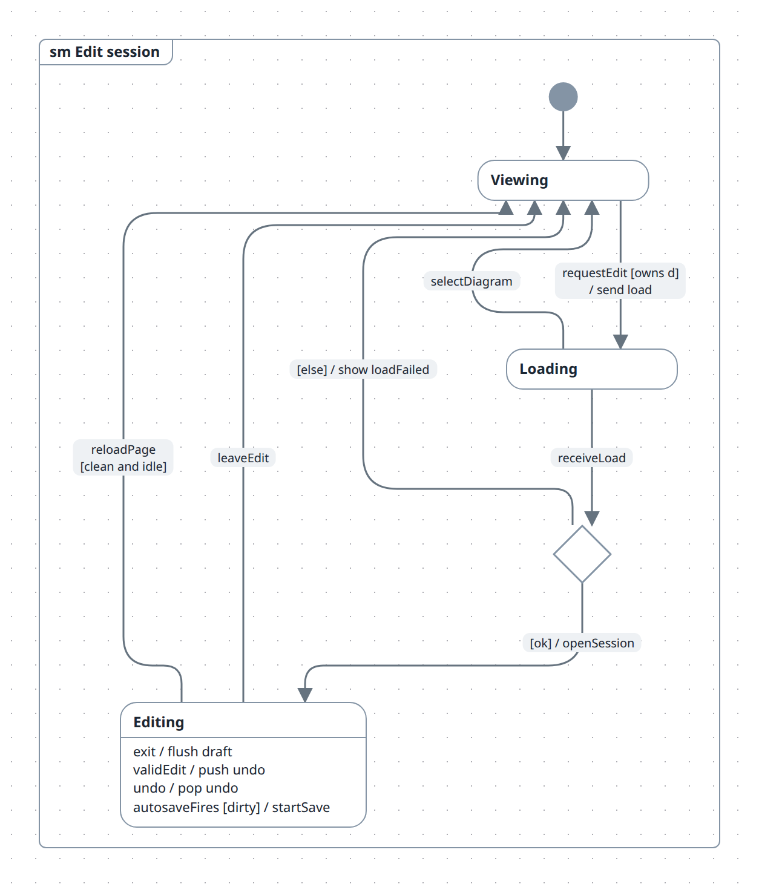
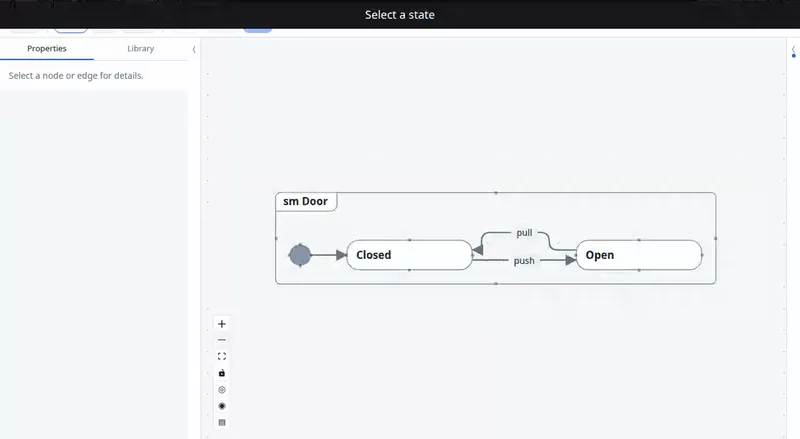
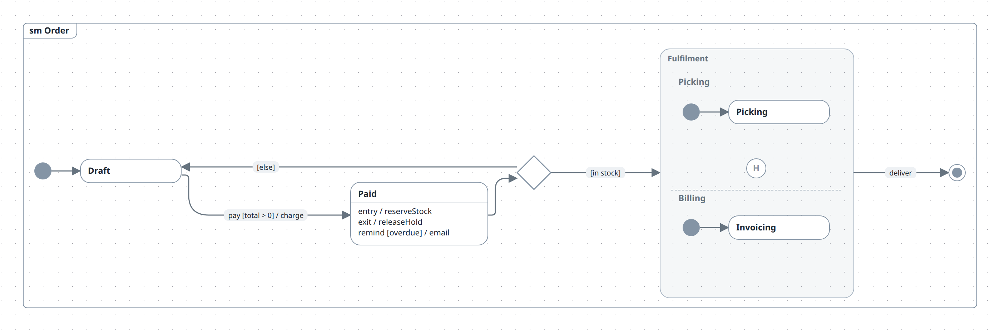
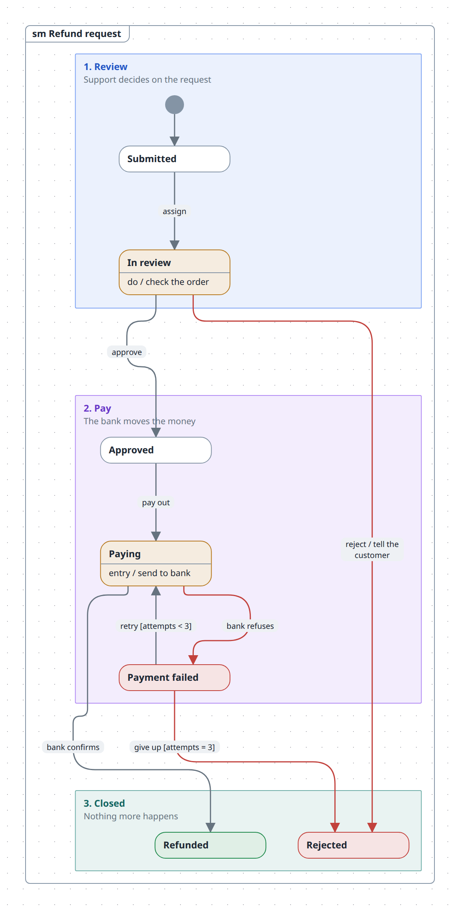
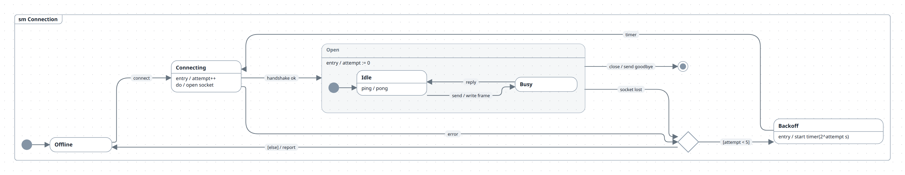

# Draw a state machine

Show how one thing moves through its modes: states, the transitions between them, and the trigger, guard and effect on each transition. It follows the UML statechart, so it also covers composite and orthogonal states and the pseudo-states a statechart uses.



## In the studio

1. Create a new JSON diagram and, in **Layers & planes**, set its **Notation** to *State machine (UML)*.
2. In the dock's state-machine panel, **add a machine**, then add states and pseudo-states into it. Select a state and press `Tab`, or click the `+` on it, to add a state beside it.
3. Connect two states by dragging from one to the other. Type the transition's text on the arrow as `trigger [guard] / effect`, for example `pay [total > 0] / charge`. Each part is kept apart, so you can leave any of them out, and a long one wraps onto more lines. Or select the transition and fill **Trigger**, **Guard** and **Effect** in the inspector.
4. Select a state to give it `entry`, `exit` and `do` behaviours, or an internal transition such as `remind [overdue] / email`.
5. Add a region to a state to make it orthogonal. A second region sits beside the first across the flow (to its right when the machine runs top to bottom), with a dashed line between them. Add an entry or exit point to a composite for a transition that crosses its border.
6. Double-click a composite state to unfold it. Every composite rests folded.
7. To show phases, press **Add zone** in the state-machine panel, or drop a **Zone** from the Library, and drop states into it. Select a state and set Properties → **Kind** to ok, failed or waiting to colour it green, red or amber.



GIF: [draw-a-state-machine.gif](../media/draw-a-state-machine.gif)

## From TypeScript

```ts
import { model } from '@diagc/core';

const m = model('order-lifecycle', { name: 'Order lifecycle' });

const order = m.stateMachine('order', { name: 'Order' });

const draft = order.state('draft', 'Draft');
const paid = order.state('paid', 'Paid', { entry: 'reserveStock', exit: 'releaseHold' });
const fulfil = order.state('fulfil', 'Fulfilment');
const held = order.state('held', 'On hold');
const inStock = order.choice('in-stock');
const done = order.final();

// Draft is a plain composite: one substate at a time.
const editing = draft.state('editing', 'Editing');
draft.initial().to(editing);
editing.to(draft.state('reviewing', 'Reviewing'), { trigger: 'submit' });

// Two regions make Fulfilment orthogonal: both run at once.
const pick = fulfil.region('pick', 'Picking');
const bill = fulfil.region('bill', 'Billing');
const picking = pick.state('picking', 'Picking');
pick.initial().to(picking);
const resumePicking = pick.history();
bill.initial().to(bill.state('invoicing', 'Invoicing'));

order.initial().to(draft);
order.transition(draft, paid, { trigger: 'pay', guard: 'total > 0', effect: 'charge' });
order.transition(paid, inStock);
order.transition(inStock, fulfil, { guard: 'in stock' });
order.transition(inStock, draft, { guard: 'else' });
order.transition(fulfil, done, { trigger: 'deliver' });

// Resuming enters Picking's history: picking goes on where it was left.
order.transition(picking, held, { trigger: 'hold' });
order.transition(held, resumePicking, { trigger: 'resume' });
order.transition(held, done, { trigger: 'cancel' });

// An internal transition: the state is not left.
paid.on('remind', { guard: 'overdue', effect: 'email' });

export default m;
```

- `m.stateMachine(id, { name? })` returns the machine. Call it again for a second machine on the same canvas. To draw a machine beside other views of the same model, give it a `plane`; without one, the whole diagram becomes a state machine.
- A machine, a state and a region each offer `state`, `initial`, `final`, `choice`, `junction`, `bar` and `terminate`. A state adds `region`, `on`, `entryPoint`, `exitPoint` and `history`, and a region adds `history`. The machine itself has no history.
- A transition is `machine.transition(from, to, { trigger?, guard?, effect? })`, or `element.to(target, parts?)`, which returns the target so a path chains. A choice's exits are guards: `[in stock]` and `[else]`.
- `machine.zone(id, name?, { note?, color? })` returns a zone: a titled, tinted area that holds states as the machine does. Zones show the phases of a process, and follow each other in the order you declare them. A zone changes nothing about the machine: `diagc lint` reads its states as the machine's own. See [Zones and colour](#zones-and-colour).
- A state is composite when something is inside it. A state with regions is orthogonal: its regions run at once. A plain composite takes `state.history()`; an orthogonal one keeps history in each region, so `region.history()`, and `state.history()` throws on a state with regions. A transition into a history state resumes the substate that was left.

## How it is drawn

A state is a rounded box with its name, and a second compartment for its behaviours when it has any. The machine is a frame with a name tab. Regions stack inside their state, separated by dashed lines. The pseudo-states keep their UML shapes: a filled dot for initial, a bullseye for final, a diamond for a choice, a circled `H` or `H*` for history. The legend names the ones that do not explain themselves.

A composite state rests folded and shows the UML composite glyph. Double-click unfolds it; siblings stay folded. Unfolding moves the other boxes, because the layout runs again.

## Zones and colour

A long machine is easier to read when it says which phase each state belongs to, and which states are ends, failures or waits. Neither is UML: both are drawing aids, and the machine means the same without them.

```ts
const review = refund.zone('review', '1. Review', { note: 'Support decides on the request' });
const pay = refund.zone('pay', '2. Pay', { note: 'The bank moves the money' });

const inReview = review.state('in-review', 'In review', { kind: 'waiting' });
const payFailed = pay.state('pay-failed', 'Payment failed', { kind: 'failed' });
```

- A zone is a square, lightly tinted area with its title and an optional note at the top. Zones follow each other along the flow in the order you declare them, each as wide as the widest. A zone sits directly in a machine, and a transition cannot end on one.
- A zone takes the next of six theme colours, or the `color` you give it. The theme colours read on a light and on a dark page.
- A state's `kind` is `ok`, `failed` or `waiting`: green, red or amber. A state without a kind stays a plain box, so the few that matter stand out. A state's own `color` wins over its kind.
- A transition into a `failed` state is drawn red. The legend lists the kinds in use.

## Lint

Every state-machine rule is a warning, so a half-drawn machine still saves and compiles. `diagc lint` reports an initial with no transition out, a choice exit without a guard, a final with a transition out, and a state no path from an initial reaches. A machine with no initial is not checked for unreachable states. The codes start with `sm-`; the full list is in the [model reference](../reference/model.md#state-machine-conventions).

## From a Quint spec

A spec's mode variable maps onto a machine: one state per value, `init` as the initial transition, and each action that changes the mode as a transition. The action's name is the trigger, its preconditions on other variables the guard, and its other updates the effect. The `any` alternatives from one mode become several transitions from one state. An action that leaves the mode alone is an internal transition. Independent mode variables that change together are orthogonal regions. The [guide](../reference/cli.md#guide) page `diagc guide state-machine` has a worked translation.

Nothing on the diagram checks a spec's invariants, and diagc neither imports nor generates a machine from Quint. Keep the invariants in a comment on the machine.

## When to reach for something else

- **Activity diagram** — a flow of actions through lanes, not the modes of one thing.
- **Plan** — what happens when, on a time axis.

## Examples

**Starter** — the listing under [From TypeScript](#from-typescript) is the whole file: an order lifecycle with Draft as a plain composite, Fulfilment as an orthogonal state of two regions, a `hold` from Picking, a `resume` back into its history and a `cancel` from On hold, a choice after Paid and an internal transition. Copy it into `.diagrams/src/` and change the names. [Source](../../.diagrams/src/examples/state-machine/starter.diagram.ts)

[](https://ferroman.github.io/diagc/html/examples/state-machine/starter.html)

**From a Quint spec** — the picture at the top of this page: the studio's own edit session, translated by hand from the `mode` variable of its Quint model. Each action that assigns `mode` is a transition, its `if` the guard and its updates the effect; the actions that leave `mode` alone are internal transitions of Editing. [Source](../../.diagrams/src/docs/state-machine.diagram.ts)

**A refund in three phases** — zones and state kinds: a refund request that support reviews, the bank pays and that ends refunded or rejected. [Source](../../.diagrams/src/examples/state-machine/zones.diagram.ts)

[](https://ferroman.github.io/diagc/html/examples/state-machine/zones.html)

**A connection that reconnects** — a protocol: a client connection that retries with backoff through a choice, gives up after five attempts, and has Open as a plain composite with an internal `ping / pong`. [Source](../../.diagrams/src/examples/state-machine/connection.diagram.ts)

[](https://ferroman.github.io/diagc/html/examples/state-machine/connection.html)

## See also

- [Builder API](../reference/builder-api.md#mstatemachineid-opts--statemachinebuilder) — `stateMachine` and the element helpers
- [Model reference](../reference/model.md#state-machine-conventions) — what the nodes, fields and rules mean
- [Look at a diagram in the terminal](look-at-a-diagram-in-the-terminal.md) — `diagc show` draws a machine in text
- [Publish and share](publish-and-share.md) — the page and the PNG work as for any diagram
