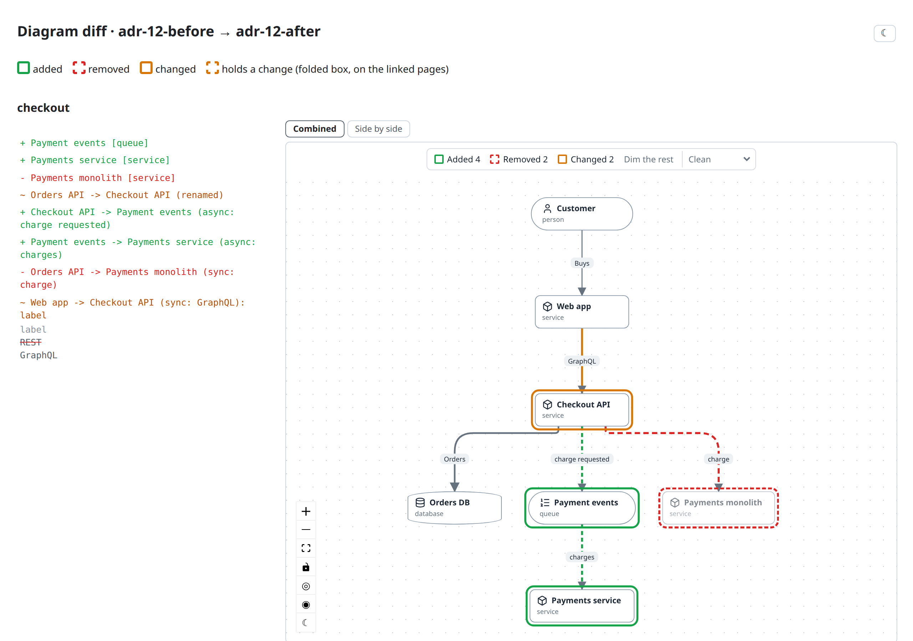

# Show what changed between two versions

Diagrams live in git, so the repository's history is the architecture's history. `diagc diff` compares the diagrams at two refs and draws the difference in one picture: what was added, what went and what changed. Use it for the pictures in an ADR, or to review a pull request that touches a diagram.

## Compare two tags

```bash
diagc diff adr-12-before..adr-12-after
```

It prints the changes per diagram:

```
diagc diff adr-12-before -> adr-12-after
checkout:
  + Payment events [queue]
  + Payments service [service]
  - Payments monolith [service]
  ~ Orders API -> Checkout API (renamed)
  + Checkout API -> Payment events (async: charge requested)
  + Payment events -> Payments service (async: charges)
  - Orders API -> Payments monolith (sync: charge)
  ~ Web app -> Checkout API (sync: GraphQL): label
1 diagram(s) changed, 14 unchanged
```

and writes, under `.diagrams/diff/adr-12-before..adr-12-after/`:

- `index.html`: every changed diagram, its change list beside one combined picture.
- `<name>.diff.html`: the combined picture as a page of its own, and `<name>.diff.png` (`<name>.diff.<plane>.png` for a later plane): a PNG of it per plane that shows a change.
- `<name>.before.png` and `<name>.after.png`: each version with the changes outlined.
- `<name>.before.html` and `<name>.after.html`: the same pictures as interactive pages.
- `summary.md`: the pictures in a before/after table, the change list and the combined pictures, ready to paste into an ADR.

`index.html` for the change above:



Any two refs work: tags, branches, commits, `HEAD~3`. Give a single ref to compare it with the working tree, including uncommitted edits:

```bash
diagc diff main                    # what this branch changed
diagc diff v1.0..v2.0 checkout     # only the checkout diagram
```

## Read the combined picture

The combined picture is the later version with everything the earlier one lost drawn back in, so one picture shows what arrived, what changed and what went.

- **Switches:** `Added`, `Removed` and `Changed` turn each kind of mark on and off, with the number of each on the plane you are looking at. Switching `Removed` off takes the removed elements out of the picture, which leaves the later version as it is. `Dim the rest` fades everything that did not change.
- **Planes:** each plane's chip carries the number of changes that plane shows. A plane that was itself added, removed or changed is underlined in the mark's colour. The page opens on the first plane that shows a change.
- **The change list:** click a line to bring that element into view. The picture moves to a plane that shows it first. A changed line shows each changed field as it was and as it is.
- **Side by side:** the button above the picture swaps it for the two versions next to each other.

Changes on a layer are drawn on the planes that switch that layer on. A layer no plane switches on is only in the change list.

## Reading the marks

| Mark                      | Combined picture                                           | Before picture                    | After picture                     |
| ------------------------- | ---------------------------------------------------------- | --------------------------------- | --------------------------------- |
| green outline             | added                                                      | —                                 | added                             |
| red dashed outline, faded | removed                                                    | removed                           | —                                 |
| amber outline             | changed (renamed, retyped, restyled, moved to another box) | changed                           | changed                           |
| amber dashed outline      | —                                                          | a folded box with a change inside | a folded box with a change inside |

Relations are coloured the same way. Positions are not compared: a box moved on the canvas is not an architecture change.

A relation is matched by what it says, not by its id. Two relations with the same ends, kind and layer are one relation that changed; with other ends, another kind or another layer they are one removed and one added. An id you gave a relation yourself is followed to other ends or another layer.

## Put it in an ADR

1. Tag the commit before the change and the one after it, or note the commits.
2. Run `diagc diff <before>..<after> <diagram>`.
3. Copy the PNGs you want next to the ADR and paste their part of `summary.md`: the before and after table, or one combined picture.

PNGs need Chrome, as for `publish`; without it, or with `--no-images`, you get the HTML pages and a summary that links to them.

## Show it on every pull request

A pull request that touches a diagram can get a comment with the change list, the before and after pictures and the combined picture, kept up to date on every push. Add `.github/workflows/diagram-diff.yml`:

```yaml
name: Diagram diff
on:
  pull_request:
permissions:
  contents: write # the pictures are pushed to a branch, so the comment can show them
  pull-requests: write # the comment
concurrency:
  group: diagram-diff-${{ github.event.pull_request.number }}
  cancel-in-progress: true
jobs:
  diff:
    runs-on: ubuntu-latest
    steps:
      - uses: actions/checkout@v7
        with:
          fetch-depth: 2 # the PR's merge commit and the base it merges into
      - uses: actions/setup-node@v7
        with:
          node-version: 24
      - uses: Ferroman/diagc/actions/pr-diagram-diff@v1.15.0 # x-release-please-version
```

What it does on each push:

1. Runs `diagc diff` between the base branch and the PR's merge commit: exactly what merging would change.
2. Pushes the PNGs to the `diagc-diff-assets` branch, under `pr-<number>/`. A comment can only show an image that has a URL, and a branch in the same repository keeps them as private as the code.
3. Writes one comment, and edits it on later pushes. If a push takes the diagram change back out, the comment says there are no changes any more.

The interactive pages are attached to the run as the `diagram-diff` artifact: download it and open `index.html`.

| Input               | Default                       |                                                                                                                                                |
| ------------------- | ----------------------------- | ---------------------------------------------------------------------------------------------------------------------------------------------- |
| `diagc`             | `npx --yes @diagc/cli@latest` | how to run the CLI; pin it (`npx --yes @diagc/cli@1.15.0`) to keep the pictures from changing with a release <!-- x-release-please-version --> |
| `assets-branch`     | `diagc-diff-assets`           | where the pictures go                                                                                                                          |
| `working-directory` | `.`                           | the directory holding `.diagrams/`                                                                                                             |
| `token`             | `github.token`                | needs the two permissions above                                                                                                                |

Two limits:

- **Pull requests from forks are skipped.** GitHub gives a fork's workflow a read-only token, so it can neither push the pictures nor comment.
- **Do not add a `paths:` filter** to the workflow. A push that removes the PR's diagram change would not run, and the comment would keep showing it. Without diagram changes and without an earlier comment, the action does nothing.

## Gotchas

- **Each version is compiled as it was.** A diagram that did not compile at one of the refs is reported (`!`) and not compared.
- **Only `.diagrams/` is read at each ref.** A local `include` that points outside `.diagrams/` cannot be resolved at an old ref.
- **Nodes match by id.** Renaming a node's _name_ is a change; changing its _id_ reads as one node removed and another added.
- **Planes that show the same changes share one combined PNG.** Planes over one structure repeat its changes, so only the first of them and each plane that shows something else get a picture. The page has every plane.
- **A field that holds a list is shown as JSON** in the change list, a state's `behaviors` for one.
- **Add `.diagrams/diff/` to `.gitignore`** unless you mean to commit the output.
- **The assets branch only grows.** Each PR's folder is replaced on every push, but a closed PR's folder stays. Delete the branch now and then; it is recreated on the next run.

See the [`diff` reference](../reference/cli.md#diff) for every option.
